# Dolphin Selector 3 – Bedienungsanleitung

Version 13.30 · Stand 28.10.2026 · AMYboard im Eurorack-Case

---

## 1. Die vier Gesten

Alles wird mit dem Navigations-Encoder (Adafruit Single #5880) bedient. Die Gesten gelten auf jeder Seite gleich.

| Geste | Wirkung |
|---|---|
| **Drehen** | Auswahl bewegen oder Wert ändern. Schnelles Drehen macht größere Schritte. |
| **Kurz drücken** | Öffnen, Bearbeiten, Bestätigen |
| **Lang drücken** (> 0,45 s) | Eine Ebene zurück. Während einer Bearbeitung: Abbruch, der alte Wert kommt zurück. |
| **Gedrückt halten und drehen** | MIDI-Kanal 1–16 wechseln, von jeder Seite aus |
| **Auf SPIELEN 2 s halten** | PANIC: alle Noten aus, Sequencer stoppt. Ein Ring zeigt den Fortschritt. |

Der M5Stack-Joystick (optional) funktioniert wie der Encoder: links/rechts ist Drehen, der Knopf ist Drücken. Auf der Drum-Seite und in Listen wechselt hoch/runter die Zeile. Ist **GRIDS › JOYSTICK>XY** oder **303 › JOYSTICK>303** aktiv, gehört der Joystick diesem Instrument und bedient die Menüs nicht mehr.

### Werte bearbeiten
- **Zahlenwerte** (z. B. Cutoff) öffnen einen großen Ring. Drehen ändert den Wert und ist sofort hörbar. Kurz drücken übernimmt, lang drücken bricht ab.
- **Auswahlwerte** (z. B. Modus) werden in der Zeile hell. Drehen, dann kurz drücken zum Übernehmen, lang drücken zum Abbrechen.
- Der **Eurorack-Modus** wird erst beim Drücken aktiv („OK=AKTIVIEREN“), damit beim Durchblättern keine Spannungen springen.
- **Schalter** (AN/AUS) wechseln mit einem kurzen Druck.

### Zusatz-Encoder E1–E8 und Q1–Q8
Unterstützt werden ein M5Stack 8-Encoder (**E1–E8**) und bis zu zwei Adafruit Quad #5752 (**Q1–Q4**, **Q5–Q8**), auch gleichzeitig. Der Single #5880 bleibt die Navigation. Für einen zweiten Quad auf der Rückseite die Lötbrücke **A0** schließen (Adresse 0x4A statt 0x49).

**SETUP › ENCODER** zeigt oben GERAETE (z. B. `M5+2QUAD`), das aktive **SET** und die DREHRICHTUNG. Darunter stehen alle gefundenen Zusatz-Encoder nach Gerät (`= M5STACK =`, `= QUAD 1 =`, `= QUAD 2 =`) mit ihrer Funktion. **Dreh an einem Zusatz-Encoder, dann springt der Cursor auf seine Zeile.** Ein Druck öffnet die Seite dieses Encoders. Auch dort wechselt das Drehen an einem anderen Zusatz-Encoder direkt zu dessen Einstellungen.

**Encoder-Seite** (Titel z. B. `E3`, rechts das Gerät). Nach der FUNKTION erscheinen nur die passenden Zeilen:

| FUNKTION | Weitere Zeilen | Wirkung |
|---|---|---|
| **AUS** | – | wird nicht abgefragt (spart I2C-Zeit) |
| **SEITE** | – | steuert die ersten Werte der offenen Seite (E1–E8 = 1.–8. Wert, Q1–Q4 und Q5–Q8 = 1.–4. Wert): auf SPIELEN die 4 Makros, im MIXER Level/Pan/Porta/Reverb, im SEQUENCER Tempo/Swing, im 303-Editor Note/Oktave/Accent/Slide, auf der Drum-Seite 8 Steps, bei GRIDS LIVE X/Y/Dichte, im Wellenform-Editor START/ENDE/LOOP A/LOOP B |
| **PATCH** | **KANAL** AKTUELL oder K1–K16 · **LISTE** ALLE, eine Kategorie (BASS, LEAD, PAD …), FAVORITEN oder DRUMKITS · **LADEN** SOFORT oder AUF DRUCK | Drehen wechselt den Patch des Kanals im laufenden Betrieb. AKTUELL folgt dem gerade gewählten Kanal. Ein Kanal mit Drumkit blättert immer durch die Drumkits. |
| **KANAL** | – | Drehen wählt den aktuellen MIDI-Kanal (wie gedrückt halten und drehen am Single) |
| **PARAMETER** | **GRUPPE** MIXER, KLANG, EFFEKTE, SEQ+SZENE, 303, DRUMS, MODULAR, AUDIO IN · **WERT** | fester Parameter, z. B. Master, Cutoff, Reverb, 303 DRIVE, IN GAIN. Beim Drehen erscheint kurz der Wert. |

Dazu auf jeder Encoder-Seite: **JETZT** (aktueller Patch oder Wert), **TASTER** (siehe unten) und **LED**.

- **LADEN SOFORT** (ab Werk): Der Patch wird nach 120 ms Ruhe geladen, der Sequencer läuft weiter. Die Einblendung zeigt z. B. `K1 JUNO 012` / `Clock Chimes`. Schnelles Drehen springt in 4er-Schritten.
- **LADEN AUF DRUCK** (für live): Drehen zeigt nur `K3 > 045 DRUCK` und den Namen, der Klang bleibt. Erst der Taster des Encoders lädt den Patch. In der Übersicht steht dann ein `*` hinter der Belegung. Der TASTER wird dabei automatisch auf KONTEXT gestellt.
- Ist der Kanal der CHROM.-Kanal des Samplers, erscheint `K1 SAMPLER`. Ist eine Liste leer (z. B. noch keine Favoriten), erscheint `LISTE LEER`.

**LED** (M5Stack und Quads): **AUTO** zeigt die Funktion als Farbe – SEITE weiß, PATCH blau, KANAL lila, AUS dunkel, PARAMETER nach Gruppe (MIXER und SEQ+SZENE gelb, KLANG und DRUMS orange, EFFEKTE grün, 303 rot, MODULAR cyan, AUDIO IN lila). Oder eine feste Farbe: AUS, ROT, ORANGE, GELB, GRUEN, CYAN, BLAU, LILA, WEISS, oder **KANAL** (Farbe des Kanals: bei PATCH K3 die Farbe von Kanal 3, sonst die des aktuellen Kanals – dieselbe Farbe wie an der Navigation).

**LEDs (v13.29)** – SETUP › ENCODER › **LEDS**. Alle LEDs zeigen jetzt, was gerade los ist:

| Zeile | Wirkung |
|---|---|
| **SINGLE** | JA = die LED des Navigations-Encoders wird angesteuert |
| **HELLIGKEIT** 1–4 | gilt für alle LEDs, 2 = wie bisher |
| = NAVIGATION = | |
| **FARBE** | Grundfarbe: **KANAL** (ab Werk, jeder der 16 Kanäle hat eine eigene Farbe) oder eine feste Farbe |
| **EDIT** | solange ein Wert bearbeitet wird (großer Ring oder Auswahl): AUTO = weiß |
| **TAKT** | Sequencer läuft: Blitz auf jeden Schlag, AUTO = Grundfarbe hell und Takt 1 weiß |
| **KANAL-BLITZ** | beim Kanalwechsel kurz hell in der Farbe des neuen Kanals |
| **PANIC** | beim Halten auf SPIELEN: AUTO = von gelb nach rot, bis PANIC auslöst |
| **WARNUNG** | blinkt bei CLIP am AUDIO IN (solange die Seite offen ist), hoher CPU-Last oder einem Speicherfehler, AUTO = rot |
| = ZUSATZ-ENC = | |
| **ZUSTAND** | gedimmt = Encoder hat gerade keine Wirkung: SEITE ohne Wert auf dieser Seite, PATCH-Kanal stumm oder leer, PARAMETER ausgeblendet. LADEN AUF DRUCK vorgemerkt = blinkt. Funktion **AUS** mit Taster START/STOP, MUTE, AUDIO IN, TAP TEMPO oder ENC-SET: die LED zeigt den Taster (START grün: läuft hell, steht gedimmt · MUTE rot: stumm hell · AUDIO IN cyan · TAP blitzt im Takt · ENC-SET A weiß, B gelb, C lila) |
| **DREH-BLITZ** | kurz heller beim Drehen |
| = ALLGEMEIN = | |
| **IM SCHONER** | AUS (ab Werk) = LEDs dunkel, solange der Bildschirmschoner läuft |
| **LED-TEST** | alle LEDs 2,4 s rot, grün, blau, weiß |

Bei jeder Anzeige schaltet **AUS** nur diese Anzeige ab. Vorrang an der Navigation: PANIC, Kanal-Blitz, Warnung, Takt, EDIT, Grundfarbe. Gesendet wird nur bei Änderung, während der Wiedergabe höchstens 3 LEDs pro Durchlauf, damit der Takt ruhig bleibt.

**Encoder-Sets A/B/C:** drei komplette Belegungen (Funktion, Optionen, Taster, LED), z. B. eine für live und eine fürs Klangschrauben. Umschalten unter SETUP › ENCODER › **SET** (drehen, Druck aktiviert) oder per Taster-Funktion **ENC-SET >** (A → B → C → A). Ein neues Set startet als Kopie des bisherigen.

**Taster** (auf der Encoder-Seite): Jeder Zusatz-Encoder hat einen Drucktaster. Kurz drücken löst beim Loslassen aus, lang (> 0,45 s) sobald die Zeit erreicht ist.

| Belegung | Kurz | Lang |
|---|---|---|
| **KONTEXT** (ab Werk) | PATCH: vorgemerkten Patch laden (AUF DRUCK), sonst Kanal stumm/an · KANAL: aktuellen Kanal stumm/an · fester Parameter: großer Ring zum Feineinstellen · SEITE auf der Drum-Seite: Step unter dem Encoder setzen | PATCH/KANAL: Patch-Browser für den Kanal |
| START/STOP | Sequencer starten/stoppen | – |
| TAP TEMPO | Tempo tippen | – |
| PANIC (LANG) | – | alle Noten aus |
| MUTE K1–K4 | Kanal stumm/an | – |
| MUTE 303 / MUTE DRUMS | Spur stumm/an | – |
| AUDIO IN | Eingang an/aus (MODULAR › AUDIO IN) | – |
| ENC-SET > | nächstes Encoder-Set | – |
| AUS | wird nicht abgefragt | |

Ab Werk: E1–E4 SEITE, E5 Master, E6 Level, E7 Reverb, E8 Echo, **Q1–Q8 PATCH K1–K8**. Die Belegung bleibt gespeichert, auch wenn ein Gerät einmal nicht angeschlossen ist. Ältere Stände behalten ihre Belegung (bisher AUS bleibt AUS).

### Statuszeile (oben)
`C1` = aktueller MIDI-Kanal · Patch-Familie (JUNO/DX7/DRUM …, `SMP` = Sampler-Kanal) · `IN` = AUDIO IN läuft · Tempo · ▶ läuft / ■ steht. Die dünne Linie darunter zeigt die CPU-Last (hell ab 85 %).

---

## 2. Menübaum

```
SPIELEN (Startseite)
├─ Patch-Zeile + Info (Stimmen, Bus, Mute)
├─ MAKRO 1–4 (Ringe) ........ Drücken = Wert bearbeiten
├─ Lauflicht der gewählten Spur
├─ START / STOP
└─ MENUE ─► Karussell
    │
    ├─ KLANG  (Kanal K#)
    │   ├─ PATCH ─► Patch-Browser
    │   │   ├─ FAVORITEN · ZULETZT
    │   │   ├─ BASS · LEAD · PAD · KEYS · BRASS/WIND · PLUCK · BELL/PERC · FX · SONSTIGE
    │   │   ├─ ALLE JUNO · ALLE DX7 · DRUMKITS
    │   │   ├─ DX7 VON SD ─► .SYX-Datei ─► Stimme 1–32
    │   │   └─ KEIN PATCH
    │   │   (auf Kanal 10 nur DRUMKITS)
    │   ├─ CUTOFF · RESONANZ ..................... Juno / AMYB
    │   ├─ ATTACK · DECAY · SUSTAIN · RELEASE ...... Juno / AMYB
    │   ├─ LFO RATE · LFO TIEFE .................. Juno / AMYB / DX7
    │   ├─ ALGORITHMUS · FEEDBACK ................ DX7
    │   ├─ AKKORD · PORTAMENTO · STIMMEN
    │   ├─ FAVORIT (JA/NEIN)
    │   ├─ CC-LEARN ─► LERN-ZIEL · LERNEN · MAPS KANAL · LOESCHEN
    │   └─ PATCH-WERTE (nur nach Änderungen: zurück auf Patch-Klang)
    │
    ├─ MIXER  (16 Fader, Drehen = Kanal wählen)
    │   └─ Drücken ─► KANAL n
    │       ├─ PATCH · LEVEL · PAN · MUTE · BUS · STIMMEN
    │       ├─ AKKORD · PORTAMENTO
    │       └─ FAVORIT · ENTFERNEN
    │
    ├─ EFFEKTE  (Bus des aktuellen Kanals)
    │   ├─ BUS (0–3) · KANAELE (wer nutzt den Bus) · PATCH-FX (AN/AUS)
    │   ├─ REVERB ─► LEVEL · LIVE · DAMP · XOVER
    │   ├─ CHORUS ─► LEVEL · RATE · DEPTH · DELAY
    │   ├─ ECHO   ─► LEVEL · ZEIT · FDBK · FILT
    │   ├─ EQ     ─► KLANGPROFIL (MANUELL/NEUTRAL/WARM/PUNCH/HELL) · LOW · MID · HIGH
    │   ├─ DISTORTION ─► TYP (AUS/CLIP/FOLD/CLIP+FOLD) · BUS DRIVE · DIST MIX
    │   ├─ MASTER · CRUSH BITS · CRUSH RATE
    │   └─ BUS RESET
    │
    ├─ SEQUENCER  (Übersicht: S1–S4, 303, DRM, START/STOP, GLOBAL)
    │   ├─ SPUR 1–4
    │   │   ├─ STEPS BEARBEITEN ............ nur Modus MANUAL
    │   │   ├─ PATTERN (A–D) · MODUS (MANUAL/EUCLID/SKALA/ARP)
    │   │   ├─ KANAL · STEPS (1–32) · TEILUNG (1/32–1/4) · NOTE · GATE
    │   │   ├─ PULSE ....................... EUCLID
    │   │   ├─ SKALA ....................... EUCLID / SKALA
    │   │   ├─ ARP RICHTUNG · ARP OKTAVEN · ARP EIN · LATCH ... ARP
    │   │   ├─ AUSGANG (INTRN/MIDI/BEIDE) · MIDI-KANAL · MUTE
    │   │   └─ KOPIE > NAECHST. · LEEREN
    │   ├─ 303 ACID
    │   │   ├─ STEPS BEARBEITEN · PATTERN (A–D)
    │   │   ├─ ACID-GENERATOR · MUTIEREN
    │   │   ├─ JOYSTICK>303 · JOY X · JOY Y · JOY TIEFE ... nur mit Joystick
    │   │   ├─ WELLE · 303 CUTOFF · RESO · ENV MOD · DECAY · ACCENT · SLIDE
    │   │   ├─ DISTORTION (AUS/CLIP/FOLD/CLIP+FOLD) · 303 DRIVE · 303 DIST MIX
    │   │   ├─ TUNE · GRUNDTON · 303 LEVEL · STEPS (1–16)
    │   │   ├─ AUSGANG · MIDI-KANAL · MUTE · CV ACCENT (5V/8V)
    │   │   └─ KOPIE > NAECHST. · LEEREN
    │   ├─ DRM ─► Drum-Raster (8 Instrumente × 16 Steps)
    │   │   └─ SPUR-MENUE (hinter dem letzten Step)
    │   │       ├─ DRUMKIT · INSTRUMENT (1–8) · SAMPLE (KIT/S1–S8) · SLICE · SOUND · NOTE
    │   │       ├─ LAENGE (1–32) · INSTR. MUTE · PULSE · EUCLID SETZEN · ZEILE LEEREN
    │   │       ├─ GRIDS ─► MODUS (PATTERN/LIVE) · GRIDS X · GRIDS Y · ZUFALL ·
    │   │       │           INSTRUMENT · DICHTE · CV IN1/2>XY · JOYSTICK>XY · IN PATTERN SCHR.
    │   │       ├─ CV TRIGGER ─► TRIG OUT1 · TRIG OUT2 · TRIG LAENGE · TRIG PEGEL
    │   │       ├─ PATTERN (A–D) · TEILUNG · KANAL
    │   │       ├─ AUSGANG (INTRN/MIDI/BEIDE) · MIDI-KANAL · SPUR MUTE
    │   │       └─ ALLE LAENGEN 16 · KOPIE > NAECHST. · LEEREN
    │   └─ GLOBAL
    │       └─ START/STOP · TEMPO · TAP TEMPO · SWING · CLOCK · TRANSPORT · M5 SCHALTER
    │
    ├─ MODULAR  (oben CV-Monitor IN1/IN2/OUT1/OUT2)
    │   ├─ MODUS (AUS · CV1>FILTER · GATE+PITCH · MIDI>CV · 303>CV · CV1>OUT1 · CV2>OUT2 · QUANTIZE)
    │   ├─ SKALA ...................... QUANTIZE
    │   ├─ CV MOD OUT1 · CV MOD OUT2 (AUS/LFO/ENV)
    │   ├─ CV LFO ─► WELLE · RATE · TIEFE · FOLD · LFO DRIVE · FOLD MIX · FOLD MOD · MOD TIEFE
    │   ├─ CV ENV ─► ATTACK · RELEASE · TIEFE · FOLD · ENV DRIVE · FOLD MIX
    │   ├─ VCO ─► VCO · 1V/OKT IN · TONHOEHE (FREI/QUANT) · SKALA · GLAETTUNG · GRUNDTON 0V · VCO FEIN · V/OKT
    │   │        WELLE · VCO PW · VCO SUB · SUB OKTAVE · VCO OSZ 2 · INTERVALL · VCO DETUNE
    │   │        MOD IN · MOD ZIEL (FM/PWM/FOLD) · VCO MOD · FOLD · VCO DRIVE · FOLD MIX
    │   │        VCO LEVEL · PAN · BUS
    │   ├─ AUDIO IN ─► AUDIO IN · MODUS (STEREO/MONO/NUR L/NUR R) · IN GAIN · IN LEVEL · IN PAN
    │   │             BREITE · BUS · BUS-EFFEKTE · FILTER · IN CUTOFF · IN RESO
    │   │             DISTORTION · IN DRIVE · DIST MIX
    │   ├─ SCOPE
    │   └─ KALIBRIERUNG ─► OUT1 OFFSET · OUT1 SKALA · OUT2 OFFSET · OUT2 SKALA · TESTSPANNUNG
    │                     IN1 OFFSET · IN1 SKALA · IN2 OFFSET · IN2 SKALA · IN1 ABGLEICH · IN2 ABGLEICH · IN WERKSWERTE
    │
    ├─ SZENEN
    │   ├─ SZENE 1–8 ─► LADEN · SPEICHERN · ALS MORPH A · ALS MORPH B · LOESCHEN
    │   └─ MORPH A>B · MORPH A · MORPH B
    │
    ├─ SAMPLER
    │   ├─ S1 … S8 ─► SLOT n
    │   │   ├─ DATEI ─► WAV-Auswahl
    │   │   ├─ WELLENFORM ─► START · ENDE · LOOP A · LOOP B · ZOOM · ANHOEREN
    │   │   ├─ ANHOEREN · AUF SD SPEICHERN (nur RAM-Slots)
    │   │   ├─ MODUS (EINMAL/GATE/LOOP) · SLICES (AUS/4/8/16) · AUF DRUMS VERTEILEN
    │   │   ├─ TAKT-SYNC · SYNC AUS LAENGE · GRAIN-SUCHE
    │   │   ├─ TUNE · FEIN · GRUNDTON
    │   │   ├─ LEVEL · PAN · BUS
    │   │   ├─ ATTACK · DECAY · SUSTAIN · RELEASE
    │   │   ├─ FILTER (AUS/TP/BP/HP/TP24/NOTCH/PHASER) · CUTOFF · RESONANZ · F-ENV · F-DECAY
    │   │   └─ NEU LADEN · LEEREN
    │   ├─ AUFNAHME ─► ZIEL-SLOT · QUELLE (LINE/MIX) · LAENGE · EINHEIT (SEK/TAKTE) ·
    │   │              START (SOFORT/TAKT 1) · DAUER · AUFNAHME · AUTO-SPEICHERN ·
    │   │              SD-SPEICHERN · EINGANG TESTEN
    │   ├─ CHROM. KANAL · CHROM. SLOT · CHROM. STIMMEN
    │   ├─ PAD-KANAL · SLICE-SLOT
    │   └─ SAMPLE-RAM · PADS (Anzeigen)
    │
    └─ SETUP
        ├─ MIDI ─► MIDI THRU · MIDI OUT TYP (A/B) · CLOCK · MONITOR · RST ALL MIDI
        ├─ ENCODER ─► GERAETE · SET (A/B/C) · DREHRICHTUNG · LEDS · E1–E8 · Q1–Q8 (nur angeschlossene) · I2C-SCAN
        │   ├─ LEDS ─► SINGLE · HELLIGKEIT · FARBE · EDIT · TAKT · KANAL-BLITZ · PANIC · WARNUNG ·
        │   │          ZUSTAND · DREH-BLITZ · IM SCHONER · LED-TEST
        │   └─ Ex/Qx ─► FUNKTION · KANAL · LISTE · LADEN · GRUPPE · WERT · JETZT · TASTER · LED
        ├─ MAKROS ─► MAKRO 1–4
        ├─ AUDIO (STEREO/MONO) · STIMMEN MAX · FAILSAFE
        ├─ DISPLAY ─► HELLIGKEIT · SCHONER NACH · UPDATE (VOLL/BAENDER)
        │   └─ SCHONER-BILD ─► BILD · WECHSEL · LEERLAUF · KONTRAST · FLYER · Auswahl (8 Bilder) · JETZT ZEIGEN
        ├─ WLAN ─► STATUS · IP · NETZ · VERBINDEN · NEU EINGEBEN · TRENNEN
        ├─ TAKT ─► SEQ-AUSGABE (DIREKT/VORAUS) · VORLAUF · VORAUS-TEST · UI-TAKT ·
        │          NOTLAUF · TRANSPORT · Status-Anzeigen
        ├─ SD EINBINDEN · SD ZUSTAND NEU · SD TEST
        ├─ INFO ─► VERSION · ENCODER · ZUSATZ · JOYSTICK · DISTORTION · TAKT-SYNC · DX7 SD (FM) · NAV-LED · I2C · RAM FREI ·
        │          LAST · STIMMEN · SPEICHER · SD · SD-GRUND · SD-TAKT · SD FREI · SPEICH.FEHLER ·
        │          Messwerte (BOOT … BEDIENUNG MAX) · MESSUNG RESET
        └─ WERKSRESET
```

Zeilen mit einem Hinweis rechts (z. B. „Juno / AMYB“) erscheinen nur, wenn sie zum aktuellen Patch oder Modus passen. Alle DISTORTION-Einträge erscheinen nur, wenn die Firmware sie kennt (SETUP › INFO › DISTORTION = JA).

---

## 3. Seiten im Detail

### SPIELEN (Startseite)
- Drehen wählt: Makro 1–4 → START/STOP → MENUE.
- Auf einem Makro zeigt die zweite Zeile den Wert. Drücken öffnet den großen Ring.
- Die Makros werden unter SETUP › MAKROS belegt. Ab Werk: Cutoff, Resonanz, Reverb, Level.
- Das Lauflicht zeigt die im SEQUENCER gewählte Spur. Bei DRM zeigt jede Zelle den lautesten Schlag dieses Steps.

### KLANG
Gilt immer für den aktuellen Kanal (gedrückt halten und drehen, um den Kanal zu wechseln).
- **Patch-Browser:** Beim Durchblättern hörst du jeden Patch sofort (er wird nach 120 ms Ruhe geladen). Kurz drücken übernimmt, lang drücken stellt den alten Patch wieder her. `*` = aktueller Patch, `+` = Favorit.
- **Klangformung:** Filter, Hüllkurve, LFO und DX7-Werte gelten erst, wenn du sie änderst. Sonst klingt der Patch wie ab Werk. Bei einem Patch-Wechsel werden diese Änderungen zurückgesetzt.
- **AKKORD:** Eine Taste spielt einen Akkord (DUR, MOLL, DUR7, … OKTAVE). Die nötigen Stimmen kommen automatisch dazu.
- **DX7 VON SD** (im Patch-Browser, nicht auf Kanal 10): eigene DX7-Bänke laden. `.SYX`-Dateien (32er-Bank oder Einzelstimme, wie aus DX7-Archiven im Netz) in den Ordner `dx7` der SD-Karte oder ins Hauptverzeichnis kopieren. Erst die Datei wählen, Drücken zeigt die Stimmen mit Namen. Beim Durchdrehen hörst du jede Stimme, Drücken übernimmt sie, lang drücken stellt den alten Klang wieder her. Die Stimme wird pro Kanal gespeichert (Datei, Nummer, Name) und beim Start von der Karte neu geladen. ALGORITHMUS, FEEDBACK und LFO wirken wie bei den eingebauten DX7-Patches. Fehlt die Datei beim Start, nimmt der Kanal den ersten eingebauten DX7-Patch („DX7 Kn · NICHT GELADEN“). SD-Stimmen erscheinen nicht unter FAVORITEN/ZULETZT, weil sie zum Kanal gehören. Szenen speichern sie mit.
  - **Wo es Bänke gibt:** [Dave Benson's DX7 Page](https://homepages.abdn.ac.uk/d.j.benson/pages/html/dx7.html) – `dx7patch.zip` mit den Original-Yamaha-ROMs `rom1a`–`rom4b` (guter Start), dazu große Sammlungen (`dx7.zip`, `deckard.zip`, `all-syx.zip`, `DX7EXTRA.ZIP`). Nicht `raw.tar` (ohne Sysex-Header). `DX7600.ZIP` enthält `.snd`-Dateien – in `.syx` umbenennen. Außerdem bringt der kostenlose DX7-Emulator [Dexed](https://www.github.com/asb2m10/dexed) rund 30 Cartridges als `.syx` mit. Lieber eine Auswahl kopieren als hunderte Dateien (Namen werden auf 14 Zeichen gekürzt).
- **CC-LEARN:** Ziel wählen (CUT/RES/LEVEL/PORTA), LERNEN drücken, am Keyboard einen Regler bewegen. Pro Kanal gibt es bis zu 4 Zuordnungen.
- Schneller Patch-Wechsel für Kanal 1–4 ohne Menü: einen Zusatz-Encoder auf **PATCH K1–K4** legen (siehe Abschnitt 1).

### MIXER
- Drehen wählt den Kanal. Die Fader zeigen den Pegel, der Punkt darunter das Panorama, „M“ steht für Mute.
- Oben rechts steht der Stimmenverbrauch, z. B. `10/24`. Hell heißt, das Budget (STIMMEN MAX) ist überschritten.
- Richtwert für die Rechenlast (AMYboard-FAQ): eine Juno-Stimme ~12 %, eine DX7-Stimme ~8 %, ein Drum-Schlag ~2 %. Ein neuer Patch auf Kanal 1 startet deshalb mit 4 Juno- oder 6 DX7-Stimmen, auf anderen Kanälen mit 2. Ein Drumkit braucht immer nur 1 Stimme – es hat für jeden Drum einen eigenen Oszillator, gleichzeitige Schläge klingen trotzdem.
- **PAN** auf einem Drumkit-Kanal verschiebt alle Drums des Kits.
- Der CHROM.-Kanal des Samplers erscheint hier wie ein normaler Kanal; LEVEL, PAN und BUS gelten für ihn.
- Drücken öffnet den Kanalzug.

### EFFEKTE
- Effekte gelten **pro Bus** (0–3). Jeder Kanal hängt an einem Bus (MIXER › KANAL › BUS), jeder Sample-Slot hat einen eigenen BUS (ab Werk 1).
- Ab Werk: Synths auf Bus 0 mit etwas Reverb, Drums (Kanal 10) und Sample-Pads auf Bus 1 trocken mit PUNCH-EQ.
- **PATCH-FX** (ab Werk AN auf Bus 0, 2 und 3): Chorus und EQ bestimmt der geladene Patch. Die Juno-Patches bringen ihren typischen Juno-Chorus und die Hochpass-Einstellung als EQ mit – ohne das klingen sie dünn. CHORUS und EQ zeigen dann „PATCH“. Sobald du Chorus, EQ oder das Klangprofil von Hand änderst, schaltet PATCH-FX für diesen Bus auf AUS und deine Werte gelten. PATCH-FX wieder AN lädt die Patches auf dem Bus neu. Liegen mehrere Kanäle auf einem Bus, gilt der Chorus des zuletzt geladenen Patches – eigene Busse helfen.
- **KLANGPROFIL** setzt den EQ auf Voreinstellungen. Wer den EQ von Hand ändert, landet auf MANUELL.
- **DISTORTION** (pro Bus): **TYP** AUS, CLIP (weiche Sättigung), FOLD (Wavefolder, metallisch) oder CLIP+FOLD. **BUS DRIVE** (1–16) bestimmt, wie stark das Signal in die Verzerrung gefahren wird, **DIST MIX** (0–1) den Anteil des verzerrten Signals. Gut für die Drums auf Bus 1: CLIP mit Drive 2–4 macht sie dichter und lauter. BUS DRIVE lässt sich als Makro oder fester Encoder belegen.
- **CRUSH** gehört in AMY zur selben Stufe wie die Distortion. Bei TYP AUS bleibt CRUSH unverändert. Bei CLIP/FOLD wirkt DIST MIX auch auf den Crush-Anteil. **CRUSH RATE** wirkt auch allein (CRUSH BITS auf AUS): dann nur Sample-Rate-Reduktion ohne Bit-Reduktion.
- **MASTER** gleicht die Lautstärke mehrerer Kanäle automatisch aus (Headroom).
- **BUS RESET** setzt alle Effekte des Busses (auch die Distortion) auf Werkswerte.

### SEQUENCER
**Übersicht:** Sechs Zeilen (S1–S4, 303, DRM) mit Lauflicht. Ein heller Strich rechts heißt: Pattern-Wechsel vorgemerkt.

**Modi der Spuren 1–4:**
| Modus | Funktion |
|---|---|
| MANUAL | Steps von Hand setzen, mit Wahrscheinlichkeit |
| EUCLID | PULSE Treffer gleichmäßig auf STEPS verteilt, Tonhöhe folgt der SKALA |
| SKALA | Jeder Step spielt die nächste Stufe der Skala |
| ARP | Spielt die auf „ARP EIN“ gehaltenen Tasten (AUF/AB/AUFAB/ZUFALL, 1–3 Oktaven, LATCH) |

Eine Spur kann auch den CHROM.-Kanal des Samplers spielen: KANAL der Spur = CHROM. KANAL.

**Step-Editor (MANUAL):** Drehen wählt den Step, Drücken schaltet ihn durch: AUS → 100 % → 75 % → 50 % → 25 % → AUS. Am Ende steht FERTIG.

**303-Editor:** Drehen wählt den Step. Jeder Druck geht ein Feld weiter: NOTE → OKTAVE → ACCENT → SLIDE → zurück zur Auswahl. E1–E4 stellen die vier Felder direkt ein.

**Patterns A–D:** Läuft der Sequencer, wechselt das Pattern erst am Ende des Durchlaufs (bei DRM nach 16 Steps). Steht er, wechselt es sofort. KOPIE > NAECHST. kopiert z. B. A nach B.

**ACID-GENERATOR** baut ein neues 303-Pattern (Moll-Pentatonik, Pausen, Accents, Slides). **MUTIEREN** ändert 3 zufällige Steps.

**303-DISTORTION:** **DISTORTION** wählt AUS, CLIP, FOLD oder CLIP+FOLD, **303 DRIVE** (1–16) die Stärke, **303 DIST MIX** den Anteil. Die Verzerrung sitzt vor dem Filter – Cutoff, Resonanz und ENV MOD formen den verzerrten Klang, wie bei der klassischen verzerrten Acid-Linie. Bei hohem Drive wird die 303 lauter: dann 303 LEVEL zurücknehmen. 303 DRIVE lässt sich als Makro oder fester Encoder belegen, MORPH A>B blendet DRIVE und MIX mit.

**JOYSTICK>303** (nur mit angeschlossenem Joystick): Der Joystick spielt die 303 live.
- **JOY X / JOY Y:** Ziel je Achse – CUTOFF, RESO, ENV MOD, DECAY, ACCENT, SLIDE, TRANSP (±12 Halbtöne), DICHTE (nach unten = Noten weglassen) oder **DRIVE** (verändert den 303 DRIVE bis Faktor 4 nach oben oder unten; wirkt nur, wenn DISTORTION nicht AUS ist). Ab Werk X = CUTOFF, Y = ENV MOD.
- **JOY TIEFE:** wie weit der Joystick die Werte verschiebt (10–100 %).
- Loslassen springt auf die gespeicherten Werte zurück. Der **Joystick-Knopf** übernimmt den aktuellen Klang als neue Grundwerte („UEBERNOMMEN“).
- Solange aktiv, bedient der Joystick keine Menüs und hat Vorrang vor JOYSTICK>XY der Drums.

**GLOBAL:**
- **CLOCK:** INTERN = eigene Uhr, SENDEN = MIDI-Clock ausgeben, FOLGEN = externer Clock (MIDI-Start/-Stop starten und stoppen den Sequencer im Takt des Masters).
- **TAP TEMPO:** mehrmals im Takt drücken. Eine Pause über 2 s beginnt neu.
- **SWING:** 0–100 %, verschiebt jeden zweiten Step (auch bei DRM, für alle Instrumente gemeinsam).
- **M5 SCHALTER:** Der Schalter am M5Stack startet und stoppt den Sequencer.

### DRUMS (Spur DRM)
Das Raster zeigt 8 Instrumente untereinander (ab Werk BD, SD, CH, OH, CP, LT, HT, RS) mit je 16 Steps. Die Helligkeit einer Zelle ist die Velocity, ein Punkt heißt „aus“. Der graue Balken ist der Abspielpunkt. Er kann pro Zeile woanders stehen, wenn die Längen verschieden sind. Spielt ein Instrument einen Sample-Slot, steht links `S1` … `S8` statt des Drum-Namens, bei einem Slice z. B. `1c` (Slot 1, Slice 3; a = 1 … p = 16).

| Bedienung | Wirkung |
|---|---|
| Drehen | Cursor durch die Steps. Am Zeilenende geht es ins nächste Instrument, nach dem letzten ins SPUR-MENUE. |
| Kurz drücken | Step: AUS → 100 % → 67 % → 40 % → AUS |
| Joystick hoch/runter | Instrument wechseln, der Step bleibt |
| E1–E8 (auf SEITE) | Die 8 Steps rund um den Cursor (1–8 oder 9–16). Drehen stellt die Velocity in 16 Stufen ein, 0 = aus. Ein Strich unter der Zeile zeigt den Bereich. Q1–Q4 auf SEITE: die ersten 4 dieser Steps. |
| Lang drücken | Zurück zur Übersicht (dabei wird gespeichert) |

- Unten stehen Instrument, Step/Länge und Velocity, darunter Pattern und Teilung. `A>B` heißt: Wechsel vorgemerkt.
- Bei Längen über 16 zeigt das Raster die Seite des Cursors (1–16 oder 17–32).

**SPUR-MENUE:**
- **DRUMKIT** wechselt das Kit auf dem KANAL der Spur (TR-808, TR-909, LINN 9000, MR-12, TOKYO, 80s POWER, PERCUSSION). Beim Durchdrehen hörst du jedes Kit sofort. Das ist derselbe Patch wie unter KLANG › PATCH auf diesem Kanal. „---“ heißt: Auf dem Kanal liegt kein Drumkit.
- **INSTRUMENT** wählt die Zeile, für die SAMPLE, SOUND, NOTE, LAENGE, INSTR. MUTE, EUCLID SETZEN und ZEILE LEEREN gelten.
- **SAMPLE:** KIT = Klang aus dem Drumkit wie bisher. **S1–S8** = das Instrument spielt stattdessen diesen Sample-Slot (beim Auswählen wird er angespielt). Velocity wirkt, MIDI-Ausgang und CV-Trigger bleiben unverändert. Slots im Modus GATE oder LOOP klingen bis kurz vor den nächsten Step.
- **SLICE** (nur wenn der gewählte Slot SLICES hat): GANZ = das ganze Sample, **1–16** = nur dieses Stück. Beim Auswählen wird das Stück angespielt. Ein Stück klingt genau seine Länge lang; ein neuer Schlag auf demselben Slot schneidet das vorige ab (wie bei einem Sampler mit Choke). So lassen sich Breakbeats neu zusammensetzen – auch mit Euclid, Polymetrik und GRIDS.
- **SOUND:** Klang des Instruments aus der GM-Liste (KICK, SNARE, CLAP, HH ZU, HH OFFN, TOMs, CRASH, RIDE, COWBELL, CONGAs, CLAVES …). Beim Durchdrehen wird jeder Klang kurz angespielt.
- **NOTE:** dieselbe Einstellung als Zahl, für Noten außerhalb der Liste (GM-Belegung, z. B. 36 BD, 38 SD, 42 CH). Dieselben Noten versteht die TR-8S ab Werk.
- **LAENGE:** 1–32 Steps pro Instrument. Unterschiedliche Längen ergeben Polymetrik, z. B. HiHat mit 12 gegen Bassdrum mit 16.
- **EUCLID SETZEN:** verteilt PULSE Schläge gleichmäßig auf die LAENGE des Instruments (überschreibt diese Zeile).
- **AUSGANG:** INTRN = Drumkit/Samples intern, MIDI = nur MIDI-Ausgang (z. B. TR-8S auf MIDI-KANAL), BEIDE = beides.
- **SPUR MUTE** schaltet die ganze Spur stumm, **INSTR. MUTE** nur ein Instrument.

**GRIDS (Pattern-Generator):**
Eine Karte mit vier Ecken erzeugt die Drum-Patterns. X und Y mischen stufenlos zwischen den Ecken:

| | X = 0 | X = 1 |
|---|---|---|
| **Y = 0** | GERADE (4/4) | BREAKBEAT |
| **Y = 1** | HALFTIME (dünn) | BROKEN (dicht) |

- **MODUS LIVE:** Das Raster zeigt und spielt das Grids-Muster statt des Patterns. Es ändert sich sofort, wenn X, Y oder DICHTE sich ändern.
- **DICHTE** (0–15, je Instrument): wie viele Schläge durchkommen. Wichtige Schläge kommen zuerst und werden lauter gespielt.
- **ZUFALL** (0–15): kleine Abweichungen bei jedem Durchlauf.
- **E1–E8** auf der Drum-Seite im LIVE-Modus: E1 = X, E2 = Y, E3–E8 = Dichte von Instrument 1–6.
- **CV IN1/2>XY:** CV IN 1 verschiebt X, CV IN 2 verschiebt Y (0–5 V = ganzer Bereich).
- **JOYSTICK>XY:** Die Auslenkung verschiebt X/Y, loslassen springt zurück.
- **IN PATTERN SCHR.** schreibt das aktuelle Muster (mit Zufall) ins gewählte Pattern und schaltet auf PATTERN. Dasselbe passiert, wenn du im LIVE-Modus einen Step drückst.
- GRIDS X und GRIDS Y lassen sich als feste Encoder oder Makros belegen, und MORPH A>B blendet sie mit.

**CV TRIGGER:**
- **TRIG OUT1 / OUT2:** Ein Instrument pro Ausgang gibt bei jedem Schlag ein Gate aus, z. B. BD → A-140-2v (Hüllkurve) für Sidechain-Pumpen. Die Trigger laufen tick-genau über AMY, synchron zum Ton.
- **TRIG LAENGE:** Gate-Länge in 1/32 (1–8).
- **TRIG PEGEL:** 5V, 8V oder VELO (0–8 V je nach Velocity).
- INSTR. MUTE schaltet nur den Klang stumm, nicht den Trigger. SPUR MUTE stoppt beides.
- Belegt ein MODULAR-Modus, CV MOD oder die Kalibrierung den Ausgang, hat das Vorrang („OUT1 BELEGT“).
- Auf der Drum-Seite zeigt ein kleiner Balken am rechten Rand, welches Instrument auf OUT1 (links) oder OUT2 (rechts) liegt. Dunkel = Ausgang belegt.

### MODULAR
| Modus | Funktion |
|---|---|
| CV1>FILTER | CV IN 1 steuert den Filter des aktuellen Kanals |
| GATE+PITCH | IN 1 = Gate, IN 2 = Tonhöhe (1 V/Okt) für den aktuellen Kanal |
| MIDI>CV | Noten des aktuellen Kanals → OUT 1 Pitch, OUT 2 Gate (5 V) |
| 303>CV | 303-Spur → OUT 1 Pitch, OUT 2 Gate (Accent optional 8 V) |
| CV1>OUT1, CV2>OUT2 | Eingang direkt durchreichen |
| QUANTIZE | IN 1 auf die gewählte SKALA quantisiert → OUT 1 |

- Pitch überall 1 V/Oktave, 0 V = C1 (MIDI 24).
- **CV MOD:** LFO oder Hüllkurve (ENV, ausgelöst von Noten des aktuellen Kanals) auf OUT 1/2. Belegt ein Eurorack-Modus den Ausgang, hat der Modus Vorrang.
- **WAVEFOLDER (v13.20):** CV LFO › FOLD (CLIP/FOLD/CLIP+FOLD) faltet den LFO in AMY. TIEFE wirkt vor dem Folder (wie der Eingangspegel), LFO DRIVE verstärkt zusätzlich, FOLD MIX blendet zwischen glatt und gefaltet. FOLD MOD = CV IN1/IN2 verschiebt den Drive per Spannung (MOD TIEFE 1 = ±2 Oktaven, 5 V = voller Ausschlag). Oben auf der Seite zeigt eine Vorschau die Welle (Näherung). LFO DRIVE und ENV DRIVE lassen sich als Makro oder Encoder belegen. CV ENV hat FOLD, ENV DRIVE und FOLD MIX ebenfalls.
- **KALIBRIERUNG:** Oben stehen IN1, IN2 (kalibriert) und OUT1 live. Immer **erst die Ausgänge, dann die Eingänge**:
  1. **Ausgang:** Multimeter (V DC) an OUT1. TESTSPANNUNG **0V**, dann OUT1 OFFSET auf 0,000 V stellen. TESTSPANNUNG **4V**, dann OUT1 SKALA auf 4,000 V stellen. SKALA wirkt bei 0 V nicht, der Nullpunkt bleibt. Kontrolle bei 1–3 V. OUT2 genauso.
  2. **Eingang:** Kabel **OUT1 → IN1**, dann **IN1 ABGLEICH** drücken. Das Board gibt 1 V und 3 V aus, misst je 0,3 s und trägt IN1 OFFSET und SKALA ein („IN1 OK +0.186V x1.005“). Für IN2 das Kabel umstecken und **IN2 ABGLEICH** drücken. `KEIN SIGNAL?` heißt: Kabel prüfen.
  3. Die Eingangs-Kalibrierung gilt überall: CV-Monitor, QUANTIZE, Grids per CV, FOLD MOD, VCO und GATE+PITCH. **IN WERKSWERTE** setzt sie zurück.
  - Ein Eingang ohne Kabel zeigt etwa 0,1–0,2 V. Bleibt ein Wert beim Umstecken stehen, kommt das Signal nicht an (Kabel).

#### VCO (v13.21)
**MODULAR › VCO** macht das AMYboard zu einem eigenständigen Oszillator: Es klingt dauerhaft (kein MIDI, kein Gate nötig), die Tonhöhe kommt per 1 V/Okt über CV IN 1 oder IN 2. Ausgang ist der normale Audio-Ausgang des AMYboards, Lautstärke und Hüllkurve machen VCA und ADSR im Rack.

| Eintrag | Wirkung |
|---|---|
| **VCO** | AN/AUS |
| **1V/OKT IN** | AUS · IN1 · IN2: welcher Eingang die Tonhöhe steuert |
| **TONHOEHE** | FREI = stufenlos (AMY rechnet die Spannung selbst, ohne Python) · QUANT = auf die SKALA gerastet |
| **GLAETTUNG** | nur bei FREI (v13.27): AUS · WENIG · STARK. Glättet das Zittern des CV-Eingangs; die Tonhöhe rechnet dann Python (ca. alle 30 ms) statt AMY. WENIG folgt Sprüngen in ca. 60 ms, STARK in ca. 200 ms – für Sequenzen AUS oder WENIG, für gehaltene Töne und Drones STARK |
| **GRUNDTON 0V** | Note bei 0 V (Werk C1, wie MIDI>CV) |
| **VCO FEIN** | ±100 Cent |
| **V/OKT** | Tracking-Abgleich 0.950–1.050, falls Oktaven nicht sauber sitzen |
| **WELLE** | SIN · TRI · SAW · PULS; **VCO PW** = Pulsbreite (nur PULS). Der Wechsel blendet kurz aus und wieder ein (ca. 65 ms, v13.27), damit es nicht knackt |
| **VCO SUB** | Pegel des Sub-Oszillators (Rechteck), **SUB OKTAVE** −1 oder −2 |
| **VCO OSZ 2** | Pegel eines zweiten Oszillators mit gleicher Welle; **INTERVALL** ±24 Halbtöne, **VCO DETUNE** 0–50 Cent (Schwebung) |
| **MOD IN** | AUS · IN1 · IN2: zweiter CV-Eingang zur Modulation |
| **MOD ZIEL** | **FM** (Tonhöhe, VCO MOD 1 = 1 Okt/V) · **PWM** (VCO MOD 1 = 0,08 pro Volt) · **FOLD** (verschiebt VCO DRIVE, 5 V = voller Ausschlag) |
| **FOLD · VCO DRIVE · FOLD MIX** | Wavefolder am Haupt-Oszillator (wie beim CV LFO) |
| **VCO LEVEL · PAN · BUS** | Pegel und Effekt-Bus (Reverb, Echo, EQ, Distortion des Busses wirken mit) |

- **Stimmen:** Oben auf der Seite stehen die aktuelle Note, die Frequenz und die Abweichung in Cent (Balken in der Mitte = genau). Zum Abgleich eine bekannte Spannung anlegen, z. B. MODUS MIDI>CV, OUT 1 → IN 1 und auf dem Keyboard C1 und C5 spielen (die Tonhöhe bleibt nach dem Loslassen stehen). GRUNDTON/FEIN so stellen, dass C1 auf 0 ct steht, dann V/OKT so, dass auch C5 0 ct zeigt.
- **FM und PWM** laufen in AMY und werden pro Audio-Block (ca. 6 ms) nachgeführt – für Vibrato, Pitch-Hüllkurven und langsame PWM gedacht, nicht für Audio-Rate-FM. FOLD-Modulation läuft alle 30 ms, QUANT folgt dem Eingang alle ca. 40 ms.
- Belegt nichts: CV1>FILTER, GATE+PITCH, Grids usw. können denselben Eingang weiter lesen.
- VCO FEIN, VCO PW, VCO SUB, VCO OSZ 2, VCO DETUNE, VCO DRIVE, VCO MOD und VCO LEVEL lassen sich als Makro oder Zusatz-Encoder belegen. Der VCO-Zustand gehört zu den Szenen. PANIC lässt den VCO weiterlaufen.
- Zeigt die Zeile VCO in MODULAR **FEHLT**, hat die Firmware keinen freien Synth (SETUP › INFO › VCO-SYNTH).

#### AUDIO IN (v13.22)
**MODULAR › AUDIO IN** schickt den Stereo-Eingang dauerhaft zum Ausgang – das AMYboard wird zum Effektgerät im Rack. Der Eingang läuft durch Distortion und Filter und danach über einen Effekt-Bus mit Reverb, Chorus, Echo, EQ, Bus-Distortion und Crush. AMY spielt den Eingang selbst, die Bedienung bremst ihn nicht.

| Eintrag | Wirkung |
|---|---|
| **AUDIO IN** | AN/AUS (ab Werk AUS) |
| **MODUS** | **STEREO** (L links, R rechts) · **MONO** (L+R zusammen auf IN PAN, je −6 dB) · **NUR L** · **NUR R** |
| **IN GAIN** | Eingangsverstärkung −24 … +12 dB, wirkt vor Distortion und Filter |
| **IN LEVEL** | Ausgangspegel |
| **IN PAN · BREITE** | Position; BREITE (nur STEREO) 1 = volle Stereobreite, 0 = beide Seiten auf IN PAN |
| **BUS** | Effekt-Bus (ab Werk 2, damit Synths und Drums ihre eigenen Effekte behalten) |
| **BUS-EFFEKTE** | öffnet EFFEKTE direkt für den Bus des Eingangs |
| **FILTER · IN CUTOFF · IN RESO** | AUS · TP · BP · HP · TP24 (· NOTCH · PHASER), wie bei den Sample-Slots. Beim Wechsel des Typs (auch bei DISTORTION) blendet der Eingang ca. 65 ms aus und wieder ein (v13.27), damit es nicht knackt |
| **DISTORTION · IN DRIVE · DIST MIX** | CLIP/FOLD vor dem Filter |

- **Pegelanzeige** oben: L und R des Eingangs (vor IN GAIN) mit Marken bei −24/−12/−6 dB, Spitzenwert rechts, **CLIP** bei Übersteuerung. Sie läuft auch bei AUS – so lässt sich der Pegel vor dem Einschalten prüfen. Darunter: Modus (ST/MO/L/R), Bus, Filter, Distortion.
- **Überall:** `IN` in der Statuszeile zeigt, dass der Eingang läuft. Mit der Taster-Funktion **AUDIO IN** (SETUP › ENCODER › TASTER) schaltet ein Zusatz-Encoder ihn von jeder Seite an und aus. IN GAIN, IN LEVEL, IN PAN, IN CUTOFF, IN RESO und IN DRIVE lassen sich als Makro oder Zusatz-Encoder belegen.
- **Szenen** speichern alle Einstellungen des Eingangs, schalten ihn aber nicht an oder aus. PANIC lässt ihn weiterlaufen.
- **Achtung Rückkopplung:** den Ausgang des AMYboards nicht auf den eigenen Eingang patchen, solange AUDIO IN an ist.
- Schlägt die Anzeige nicht aus: DIP-Schalter auf der Rückseite, Kabel und Pegel prüfen. Zeigt MODULAR **FEHLT**, hat die Firmware keine freien Synths (SETUP › INFO › AUDIO IN).

### SZENEN
- Eine Szene speichert Klang, Mixer, Effekte (auch die Bus-Distortion), den VCO, die AUDIO-IN-Einstellungen (nicht AN/AUS), Tempo, Swing und alle Sequencer-Patterns (auch die Drum-Spur mit ihrer SAMPLE-Zuordnung und die 303 mit ihrer Distortion). Encoder-, MIDI-, WLAN- und **Sampler-Einstellungen** gehören nicht dazu.
- **MORPH A>B** blendet stufenlos zwischen zwei Szenen: Pegel, Pan, Filter, Effekte, Master, Tempo, 303-Klang (inkl. 303 DRIVE und DIST MIX), Grids X/Y. Patches wechseln nur beim LADEN.
- Tipp: MORPH auf einen Zusatz-Encoder legen.

### SAMPLER
Der Sampler hat **8 Slots** (S1–S8). Ein Slot zeigt auf eine WAV-Datei auf der SD-Karte oder hält eine Aufnahme im RAM. In der Liste steht rechts der Name, `LEER`, `LAEDT`, `RAM`, `REC...` (Aufnahme läuft) oder eine Fehlermeldung.

**Eigene Samples auf die Karte bringen:**
- WAV-Dateien am PC in den Ordner `samples` der SD-Karte kopieren (oder ins Hauptverzeichnis).
- Unterstützt: **16 Bit PCM, mono oder stereo, jede Samplerate**. Stereo wird beim Laden zu mono gemischt. Nicht unterstützt: 24/32 Bit, Float, komprimierte Formate (die Dateiauswahl meldet dann z. B. `NUR 16 BIT`).
- Geladen werden höchstens **10 s** pro Slot (der Bereich START…ENDE).

**Slot-Seite (S1 … S8):**
- **DATEI:** WAV auswählen und mit Drücken laden. Der Slot wird dabei einmal angespielt. Dateien aus dem Hauptverzeichnis stehen mit `/` davor.
- **WELLENFORM:** der Editor (siehe unten). Nur bei Slots mit Datei.
- **ANHOEREN:** spielt den Slot einmal.
- **MODUS:**

| Modus | Verhalten |
|---|---|
| EINMAL | spielt immer bis zum Ende (Note-Off wird ignoriert) – ideal für Drums |
| GATE | stoppt beim Loslassen (bricht hart ab, ohne Release) |
| LOOP | wiederholt LOOP A…B, solange gehalten wird; danach folgt RELEASE |

- **SLICES** (nicht im Modus LOOP): AUS, 4, 8 oder 16 gleich lange Stücke des geladenen Bereichs. Im Wellenform-Editor zeigen gestrichelte Linien die Grenzen. Gespielt werden die Stücke über die Drum-Spur (SPUR-MENUE › SLICE). Über MIDI spielen die PAD-KANAL-Noten 44–59 die Stücke (siehe „Spielen“). ANHOEREN spielt das ganze Sample.
  - **AUF DRUMS VERTEILEN** legt Slice 1–8 auf Instrument 1–8 (SAMPLE = dieser Slot, LAENGE 16) und schreibt das Originalmuster ins aktuelle Drum-Pattern: Slice 1 auf Step 1, die übrigen gleichmäßig verteilt (geht davon aus, dass der Slot 1 Takt lang ist). Danach spielt die Drum-Spur den Loop wie das Original – jetzt lassen sich die Steps umstellen. Vorher wird nachgefragt, weil die Zeilen 1–8 überschrieben werden. Bei 16 Slices kommen nur 1–8 auf die Instrumente.
  - **Zusammen mit TAKT-SYNC** dauert jedes Stück genau TAKT-SYNC ÷ SLICES (z. B. 1 TAKT / 8 = eine Achtel) und folgt dem Tempo – der Break bleibt bei jedem Tempo im Raster, ohne Tonhöhenänderung.
- **TAKT-SYNC** (nicht im Modus LOOP): AUS oder 1 Schlag … 10 Takte. Der Slot dauert dann immer genau so lang, egal welches Tempo läuft – auch bei Tempowechseln während der Note – und behält dabei seine Tonhöhe (granularer Time-Stretch in AMY). Ideal für Loops und Phrasen: ein 2-Takt-Loop bleibt bei 90 wie bei 140 BPM im Takt. TUNE, FEIN und der CHROM.-Kanal transponieren, ohne die Dauer zu ändern.
  - **SYNC AUS LAENGE** schlägt den passenden Wert aus Länge und aktuellem Tempo vor (rechts angezeigt) und übernimmt ihn per Druck.
  - **GRAIN-SUCHE** (0–512, ab Werk 64): wie weit der Stretcher nach passenden Stellen sucht. Bei tiefen Klängen (Bass) kann ein höherer Wert sauberer klingen, 0 = feste Grains (stabiler, kammartiger Klang).
  - Aufnahmen mit EINHEIT TAKTE bekommen TAKT-SYNC automatisch (z. B. 2 Takte → 2 TAKTE).
  - Ein Slot mit TAKT-SYNC braucht beim Spielen etwa 2,5-mal so viel Rechenzeit wie ohne – bei vielen gleichzeitig auf die CPU-Last achten.
- **TUNE** (±24 Halbtöne) und **FEIN** (±50 Cent): Tonhöhe, wirken sofort.
- **GRUNDTON:** die Taste, auf der das Sample im CHROM.-Kanal original klingt (ab Werk C4 = Note 60).
- **LEVEL · PAN · BUS:** gelten für das Pad (der CHROM.-Kanal nimmt die Mixer-Werte seines Kanals). Über den BUS bekommt ein Slot auch die Bus-Distortion.
- **ATTACK · DECAY · SUSTAIN · RELEASE:** Lautstärke-Hüllkurve.
- **FILTER** (AUS/TP/BP/HP/TP24, dazu **NOTCH** und **PHASER**, wenn die Firmware sie kennt) mit **CUTOFF**, **RESONANZ**, **F-ENV** (Filter-Hüllkurve, ±6 Oktaven) und **F-DECAY**. NOTCH schneidet ein schmales Band heraus, PHASER ist ein klassischer 3-Kerben-Phaser – mit F-ENV oder CUTOFF auf einem Encoder bewegt er sich hörbar.
- **NEU LADEN:** lädt die Datei neu, z. B. nachdem sie auf der Karte ersetzt wurde.
- **LEEREN:** gibt den Slot frei. Die Datei bleibt auf der Karte.

**Wellenform-Editor (zerstörungsfreies Trimmen):**
- Oben die Wellenform: hell = geladener Bereich, durchgezogene Striche = START und ENDE, gestrichelt = LOOP A und B (nur im Modus LOOP).
- **Drehen** wählt das Feld: START, ENDE, LOOP A, LOOP B, ZOOM, ANHOEREN.
- **Drücken** bearbeitet das Feld (dann ändert Drehen den Wert), schaltet den ZOOM um (1x/8x/64x) oder spielt an.
- **Lang drücken** beendet die Bearbeitung, ein zweites Mal geht zurück.
- Langsames Drehen bewegt den Marker um 1 Pixel, schnelles bis zu 16 Pixel. Mit Zoom 64x geht es auf Millisekunden genau.
- **E1–E4** (oder Q1–Q4) stellen START, ENDE, LOOP A und LOOP B direkt ein.
- Etwa 0,5 s nach der letzten Änderung wird neu geladen und einmal angespielt. Die Datei selbst wird nie verändert.

**Spielen – drei Wege:**
1. **Pads über die Drum-Spur:** Drum-Spur › SPUR-MENUE › SAMPLE = Slot (siehe DRUMS).
2. **PAD-KANAL:** MIDI-Kanal wählen. Auf diesem Kanal spielen die **MIDI-Noten 36–43 die Slots 1–8** mit Anschlagstärke (je nach Gerät C1–G1 oder C2–G2). Jeder Slot ist einstimmig, ein neuer Anschlag schneidet den alten ab. Gut für eine Drum-Spur des KeyStep Pro.
   - **Noten 44–59 spielen die Slices** des **SLICE-SLOT** (Note 44 = Slice 1 … 59 = Slice 16, nur so viele, wie der Slot SLICES hat). Jedes Stück klingt seine Länge lang (mit TAKT-SYNC im Tempo). Im Modus GATE stoppt Loslassen früher. Die Liste zeigt neben jedem Slot die Anzahl seiner Slices.
3. **Chromatisch:** **CHROM. KANAL** auf einen freien MIDI-Kanal stellen (nicht 10, nicht der Juno-Kanal – der Sampler ersetzt dort den Patch). **CHROM. SLOT** wählt den Slot, **CHROM. STIMMEN** die Polyphonie (1–8). Dann spielt die Tastatur den Slot über alle Tonhöhen. Auch die Sequencer-Spuren 1–4 können diesen Kanal spielen.

**AUFNAHME:**
- **ZIEL-SLOT:** in welchen Slot aufgenommen wird. Ein belegter Slot wird nach Rückfrage überschrieben; eine Datei auf der Karte bleibt dabei erhalten.
- **QUELLE:** LINE = Line-Eingang, MIX = der eigene Ausgang (Resampling, z. B. ein Sequencer-Loop).
- **LAENGE / EINHEIT:** 1–10 Sekunden oder 1–10 Takte beim aktuellen Tempo, höchstens 10 s. **DAUER** zeigt das Ergebnis.
- **START:** SOFORT oder **TAKT 1** – bei laufendem Sequencer beginnt die Aufnahme taktgenau am nächsten Taktanfang (Anzeige `WARTE`).
- **AUFNAHME** drücken startet. Während der Aufnahme zeigt die Zeile `STOP xx %`, ein Druck stoppt vorzeitig. Bedienung und Sequencer laufen weiter, die Aufnahme ist lückenlos (AMY nimmt selbst auf).
- Danach ist der Slot sofort spielbar. Mit EINHEIT TAKTE ist TAKT-SYNC schon passend eingestellt – die Aufnahme bleibt auch bei späteren Tempowechseln im Takt.
- **AUTO-SPEICHERN** (ab Werk AN): Direkt nach der Aufnahme wird sie als WAV `/sd/samples/RECnnn.wav` gespeichert („Sn GESPEICHERT“), und der Slot zeigt auf diese Datei – dann gehen auch Trimmen und Wellenform. Während des Speicherns kann der Ton kurz stocken (SD-Karte und Sample-Speicher teilen sich einen Bus).
- Ist AUTO-SPEICHERN AUS, zeigt der Slot `RAM`. Mit **SLOT › AUF SD SPEICHERN** lässt er sich später speichern, z. B. wenn gerade nichts spielt. **RAM-Aufnahmen sind nach dem Ausschalten weg.**
- Speichern braucht eine neue AMYboard-Firmware mit `tulip.store_sample` (zunächst aus dem Test-Editor `amyboard-pr-1399`). **SD-SPEICHERN** auf der AUFNAHME-Seite zeigt JA oder FIRMWARE FEHLT. Ohne passende Firmware bleiben Aufnahmen nur im RAM.
- **EINGANG TESTEN:** misst 2 s lang, was an der QUELLE ankommt: neue Blöcke, Bytes pro Block, **PEGEL**, freier RAM und die Schreibzeit der SD-Karte. Zeigt LINE 0 % Pegel, kommt am Eingang nichts an (Kabel, Pegel, DIP-Schalter auf der Rückseite prüfen).

**Anzeigen:** **SAMPLE-RAM** = belegter Sample-Speicher. **PADS** = wie viele Slots als Pad spielbar sind (8/8).

### SETUP
- **RST ALL MIDI** entfernt die Patches von allen Kanälen.
- **MIDI › MONITOR** zeigt die letzten 8 MIDI-Ereignisse, die beim Sketch ankommen, neuestes oben: Kanal, Art (`N` Note, `CC`, `PC`) mit Nummer und rechts, was der Sketch damit gemacht hat – `PAD S1`, `SLICE 3`, `KANAL 1` oder ein Grund wie `S2 LEER`, `S1 KEINE SLICE`. Oben rechts zählt alle empfangenen Nachrichten (auch Clock). Druck leert die Liste.
- **ENCODER:** **GERAETE** zeigt die erkannten Zusatz-Geräte (z. B. `M5+2QUAD`). **I2C-SCAN** listet jedes Gerät am Bus mit Adresse, erkanntem Typ und Seesaw-Produktnummer (P5752 = Quad). Fehlt ein Encoder im Menü, zeigt diese Liste, ob er überhaupt antwortet und als was er erkannt wird. Dazu SET, DREHRICHTUNG, **LEDS** und die Übersicht aller angeschlossenen Encoder E1–E8 und Q1–Q8 (siehe Abschnitt 1).
- **FAILSAFE** begrenzt die Rechenlast. Bei Überlast werden Stimmen abgeschaltet statt zu knacken.
- **DISPLAY:** **HELLIGKEIT** (Kontrast), **SCHONER NACH** (dimmt nach 1–30 min ohne Eingabe; die erste Eingabe weckt nur), **UPDATE** BAENDER = nur geänderte Bildteile senden (schont den Takt), VOLL = immer das ganze Bild (falls das Bild fehlerhaft ist).
- **DISPLAY › SCHONER-BILD (v13.30):** Der Bildschirmschoner zeigt Delfine, die auf die Musik reagieren:

  | Bild | Was passiert | Reagiert auf |
  |---|---|---|
  | **SPRUNG** | Delfin springt aus den Wellen | läuft: einmal pro Takt, sonst alle 6 s |
  | **SONAR** | Radarstrahl, Delfine leuchten als Echo auf | jede Bassdrum schickt einen Ping-Ring |
  | **TUNNEL** | Delfin fliegt durch einen Rechteck-Tunnel | Tempo, Bassdrum gibt Schub |
  | **TERMINAL** | fallender Hex-Code, ASCII-Delfin, Zeile mit Kanal und BPM | die echten MIDI-Bytes, die ankommen |
  | **FLYER** | Rave-Plakat mit Name, Raster-Delfin, BPM und Kanal | neues Layout alle 4 Takte, Strobo-Blitz auf Takt 1 |
  | **ACID-SPUR** | Delfin surft auf der 303-Linie (Slides = Rampen, Accents = Wellenberge) | 303-Pattern; steht die 303, kommt SPRUNG |
  | **SPEKTRUM** | 12 Frequenzbalken, Flosse auf dem lautesten | der Audio-Ausgang |
  | **WAREHOUSE** | Laserlinien und Delfin-Schatten im Nebel | Richtung wechselt jeden Takt |

  - **BILD:** **ZUFALL** (ab Werk) wechselt zufällig zwischen den ausgewählten Bildern, nie zweimal dasselbe hintereinander. Oder ein festes Bild, oder **TEXT** (der bisherige ruhige Schoner).
  - **WECHSEL:** nach 1, 2 (ab Werk), 5 oder 10 Minuten kommt das nächste Bild.
  - **LEERLAUF:** nach **30 MIN** (ab Werk), **1 STD** oder **4 STD** Schoner übernimmt das **Leerlauf-Signal**: ein langsam pulsierender Delfin-Umriss, der jede Minute den Platz wechselt, mit niedrigstem Kontrast. Schont das Display über Nacht.
  - **KONTRAST:** DUNKEL, MITTEL (ab Werk) oder HELL, solange der Schoner läuft.
  - **FLYER:** Name auf dem Flyer (Zeichenrad, bis 10 Zeichen, ab Werk DOLPHIN).
  - **Auswahl:** jedes der 8 Bilder einzeln AN/AUS für den Zufall. Sind alle aus, läuft TEXT.
  - **JETZT ZEIGEN** startet den Schoner sofort – zum Ausprobieren. Jede Eingabe weckt ihn wieder.
  - **SCHONER NACH** bestimmt weiter, wann er startet.
  - Der Takt hat Vorrang: Während der Wiedergabe kommt höchstens alle 0,4 s ein Bild, in Streifen gesendet. Im Stillstand alle 0,2 s.

  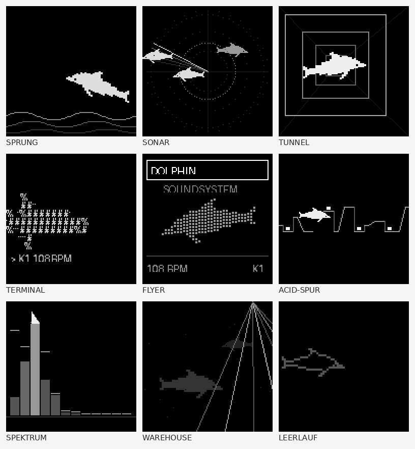
- **TAKT:**
  - **SEQ-AUSGABE VORAUS** (ab Werk): Noten werden um **VORLAUF** (ab Werk 250 ms) im Voraus berechnet und von AMY tick-genau gespielt – Display, Encoder und Speichern können den Takt nicht verschieben. **DIREKT** spielt sofort (nur zum Vergleich).
  - **VORAUS-TEST:** ein Clap sofort, dann zwei weitere je 2 Schläge später. Klingen alle drei gleichzeitig, plant die Firmware nicht voraus → SEQ-AUSGABE auf DIREKT stellen.
  - **UI-TAKT TIMER** (ab Werk): Die Bedienung läuft über einen eigenen Timer. **NOTLAUF** (nur bei UI-TAKT LOOP) hält die Bedienung am Leben, wenn der AMY-Takt steht. **TRANSPORT** EIGEN/AMY.
- **WLAN:** Zugangsdaten mit NEU EINGEBEN (Zeichenrad) speichern. Sie liegen im Klartext auf der SD-Karte (`wifi_credentials.txt`). Nach VERBINDEN läuft WebREPL (Passwort `amyboard`).
- **SD EINBINDEN** bindet die SD-Karte neu ein, ohne Neustart – z. B. nach einem Kartentausch. Es wird mit 32 KB geprüft; scheitert das Schreiben, werden niedrigere Takte und Pull-ups probiert. Die funktionierende Einstellung wird gemerkt und beim nächsten Start verwendet. Danach wird der Stand samt Szenen auf die Karte geschrieben („SD OK · GESPEICHERT“ oder z. B. „OK 10M“). Scheitert es, nennt die Meldung den Grund.
- **SD ZUSTAND NEU** löscht `dolphin_state.json` (mit `.tmp`/`.bak`) auf der Karte und schreibt den aktuellen Stand frisch. Die Einstellungen bleiben erhalten. Hilft bei einer beschädigten Zustandsdatei.
- **SD TEST** prüft Schritt für Schritt: Schreiben 4 KB / 32 KB / am Stück / mit Flush, den echten Zustand, Umbenennen, Lesen. Jede Zeile zeigt `OK` mit Zeit oder eine Fehlernummer (`E5` = E/A-Fehler). Scheitert das Schreiben, folgt eine Liste aller Takte (20 MHz … 400 kHz) ohne und mit Pull-up (`PU`), dazu GEWAEHLT und ZUSTAND.
- **INFO:**
  - **DISTORTION:** JA = die Firmware kennt die Distortion-Befehle. Bei NEIN sind alle DISTORTION-Einträge ausgeblendet.
  - **DX7 SD (FM):** JA = `fm.py` ist auf dem Board vorhanden, DX7 VON SD funktioniert.
  - **NAV-LED:** Nummer der LED des Navigations-Encoders (amyboard zählt die LEDs aller Geräte fortlaufend) oder KEINE.
  - **TAKT-SYNC:** JA = die Firmware kennt den Time-Stretch (`fit`). Bei NEIN sind TAKT-SYNC, SYNC AUS LAENGE und GRAIN-SUCHE ausgeblendet.
  - **SPEICHER:** wo der Zustand gespeichert wird (`/sd/` oder intern `/user/`).
  - **SD:** OK, NEU EINGEH. (beim Start neu eingehängt), WECHSEL (Speichern auf der Karte gescheitert) oder der Fehlergrund. **SD-GRUND:** warum zuletzt von der Karte weggewechselt wurde. **SD-TAKT:** STD oder z. B. `10M PU`. **SD FREI:** freier Platz.
  - **Messwerte** (für die Fehlersuche): BOOT, RAM NACH BOOT, ZEICHNEN/SENDEN/SEQ/SPEICHERN/BEDIENUNG MAX, VERPASST, SPAET, TICK-ABW, CV-TRIGGER. **MESSUNG RESET** setzt sie zurück.
- **WERKSRESET** setzt alles zurück, löscht die Zustandsdateien an allen Orten und startet neu. Szenen und Dateien auf der Karte bleiben erhalten.

**Meldungen von SD EINBINDEN:**
| Meldung | Bedeutung |
|---|---|
| KEIN FAT32 | Kein lesbares Dateisystem – Karte als FAT32 (MBR) formatieren, nicht exFAT |
| KEINE ANTWORT / FEHLT | Keine Karte erkannt – Sitz prüfen oder andere Karte |
| E/A-FEHLER | Karte meldet Fehler (EIO) |
| SCHREIBFEHLER | Schreiben scheitert bei allen Takten – Karte, Slot oder Stromversorgung prüfen |
| TMP+DIR E/A … | Testdatei ging, der Zustand aber nicht – SD TEST ausführen |

---

## 4. Speichern

- Alle Einstellungen werden **automatisch** gespeichert: 2,5 s nach der letzten Änderung, spätestens nach 10 s. **Während der Sequencer läuft**, wird erst bei STOP gespeichert (spätestens nach 5 min), damit das Speichern den Takt nicht stört.
- Dateien: `dolphin_state.json` (Zustand) und `dolphin_scenes.json` (Szenen), bevorzugt auf der SD-Karte. Zum Zustand gehören auch die Slot-Einstellungen des Samplers (Datei, Trim, Klang) – nicht aber RAM-Aufnahmen.
- Die Datei wird sicher geschrieben (`.tmp` → Hauptdatei, alte Datei → `.bak`). Ein Stromausfall zerstört nie den letzten guten Stand.
- Liefert die SD-Karte Schreibfehler, speichert der Sketch automatisch intern (`/user/`) und meldet „SD-FEHLER“. Beim Start wird immer der neueste Stand von allen Orten geladen.
- Beim Start werden alle Sample-Slots im Hintergrund von der Karte geladen (Anzeige `LAEDT`).
- **Vor dem Ausschalten:** STOP drücken oder ein paar Sekunden warten.

---

## 5. Meldungen und Hilfe

| Meldung | Bedeutung / Abhilfe |
|---|---|
| PANIC · ALLE NOTEN AUS | Nach 2 s Halten auf SPIELEN |
| HOHE CPU-LAST | Weniger Stimmen, Effekte oder Kanäle. FAILSAFE prüfen. |
| SD-FEHLER · SPEICHERE /user/ | Karte meldet Schreibfehler. SETUP › SD EINBINDEN oder SD TEST. |
| SPEICH.xxx + Fehlertext | Speichern ist überall gescheitert. Den Text notieren. |
| ZUSTAND · UEBERNOMMEN | Stand von einem anderen Ort oder Backup geladen |
| KEIN ZUSTAND | Nichts gefunden, Start mit Werkseinstellungen |
| SPEICHER INTERN · SETUP>SD NEU | Beim Start war keine SD-Karte beschreibbar – es wird intern gespeichert |
| SD OK / SD FEHLER | Ergebnis von SD EINBINDEN (siehe SETUP) |
| K1 JUNO 012 · Clock Chimes | Patch per Zusatz-Encoder (PATCH K1–K4) gewechselt |
| S1 SYNC · 2 TAKTE | SYNC AUS LAENGE übernommen |
| DX7 · FM.PY FEHLT | Die Firmware hat kein `fm.py` – DX7 VON SD geht nicht |
| DX7 · KEINE STIMMEN | Die .SYX-Datei ist keine gültige DX7-Datei |
| DX7 Kn · NICHT GELADEN | Gespeicherte SD-Stimme fehlt – Kanal nimmt DX7-Patch 1 |
| K1 · MUTE / AN | Kanal per Encoder-Taster stumm/an |
| DRUMS · 8 SLICES S1 | AUF DRUMS VERTEILEN ausgeführt |
| K1 SAMPLER · PATCH IM SAMPLER | Kanal ist der CHROM.-Kanal des Samplers – Patch-Wechsel dort nicht möglich |
| Sn IN RAM · NICHT AUF SD! | Aufnahme fertig, aber nicht gespeichert (AUTO-SPEICHERN AUS oder Firmware ohne store_sample) – geht beim Ausschalten verloren |
| Sn GESPEICHERT · RECnnn | Aufnahme als WAV auf der Karte gespeichert |
| SPEICHERN · FIRMWARE ZU ALT | Firmware ohne tulip.store_sample – neue Firmware flashen |
| WARTE AUF TAKT 1 | Aufnahme startet am nächsten Taktanfang |
| LAEDT NOCH | Der Slot wird gerade geladen – kurz warten |
| NUR 16 BIT · KEIN WAV · NICHT PCM | Datei hat ein nicht unterstütztes Format |
| KEIN PAD-SYNTH | Slot kann nicht als Pad gespielt werden (PADS < 8/8) |
| 303 · UEBERNOMMEN | Joystick-Klang der 303 als Grundwerte übernommen |
| EUCLID · BD 5/16 | EUCLID SETZEN ausgeführt (Instrument, Schläge/Länge) |
| GRIDS · > PATTERN | Grids-Muster ins Pattern geschrieben, Modus jetzt PATTERN |
| OUT1 BELEGT | Der Ausgang wird von MODULAR benutzt, der Trigger ist still |

Hängt der Ton: auf SPIELEN 2 s halten (PANIC).

---

## 6. Tipps und Tricks

### Bedienung
- **Kanal wechseln von überall:** Encoder gedrückt halten und drehen. Du musst dafür nicht zurück auf SPIELEN.
- **Lang drücken heißt „zurück wie vorher“:** Im großen Ring, bei Auswahlwerten und im Patch-Browser stellt ein langer Druck den alten Wert wieder her. So kannst du gefahrlos durchhören.
- **Die vier Makros** auf SPIELEN sind die schnellsten Regler. Lege unter SETUP › MAKROS die vier Werte drauf, die du im Stück am meisten brauchst, z. B. Cutoff, 303 DRIVE, Reverb und MORPH A>B.
- **PANIC** (2 s auf SPIELEN) stoppt alle Noten und den Sequencer. VCO und AUDIO IN laufen absichtlich weiter. Zum Stummschalten nimmst du deren Schalter AN/AUS.

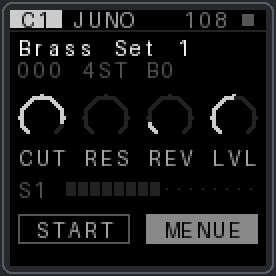

### Zusatz-Encoder live
- **Zwei Encoder-Sets anlegen:**
  - **Set A für den Auftritt:** PATCH mit LADEN AUF DRUCK, die Taster auf MUTE K1–K4, START/STOP und TAP TEMPO.
  - **Set B zum Klangschrauben:** PARAMETER wie Cutoff, Reso, 303 DRIVE und Reverb.
  - Ein Taster mit **ENC-SET >** schaltet zwischen den Sets um.
- **LADEN AUF DRUCK:** Wähle den nächsten Patch schon während des Takts vor und drücke genau auf die Eins. So landet der Wechsel im Takt.
- **LED-Farben:** AUTO zeigt die Funktion. Mit **KANAL** tragen die PATCH-Encoder dieselbe Farbe wie die Navigation, wenn dieser Kanal gewählt ist – so findest du den richtigen Regler ohne hinzusehen. Gedimmte LEDs (ZUSTAND) zeigen stumme Kanäle und Regler ohne Wirkung auf der offenen Seite.
- **TAKT an der Navigation:** Der Blitz auf jeden Schlag (Takt 1 weiß) hilft beim Einzählen für LADEN AUF DRUCK und beim Starten im Takt mit dem KeyStep.
- **MORPH A>B** auf einen Encoder legen (Gruppe SEQ+SZENE). Speichere Szene A als ruhigen Teil und Szene B als Höhepunkt, dann drehst du den Übergang von Hand.

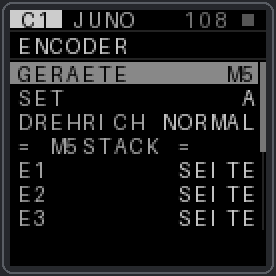

### Drums und Sequencer
- **Polymetrik:** Gib einzelnen Instrumenten eine andere LAENGE. Die HiHat mit 12 oder 7 gegen die Bassdrum mit 16 klingt lebendig, ohne dass du ein Pattern programmierst.
- **EUCLID SETZEN:**
  - 4 Schläge auf 16 sind die gerade Bassdrum.
  - 5/16, 7/16 oder 3/8 klingen nach Clave und Afro-Groove.
  - Kombiniere das mit LAENGE für wandernde Muster.
- **GRIDS als Ideengeber:**
  - Stell MODUS auf LIVE und such mit E1 (X) und E2 (Y) ein Muster.
  - Gefällt es, hält **IN PATTERN SCHR.** es fest. Danach kannst du es Step für Step verfeinern.
- **Variationen:**
  - Pattern A fertig bauen, **KOPIE > NAECHST.** kopiert es nach B, dort änderst du nur ein paar Steps.
  - Der Wechsel A→B kommt immer zum Ende des Durchlaufs, also taktgenau.
- **303:**
  - Starte mit dem ACID-GENERATOR. **MUTIEREN** ändert nur 3 Steps, so entwickelt sich die Linie, ohne ihren Charakter zu verlieren.
  - DISTORTION CLIP sitzt vor dem Filter. Mit hoher RESO und ENV MOD entsteht der klassische verzerrte Acid-Sound.
  - Mit dem Joystick findest du live einen Klang, der **Joystick-Knopf** übernimmt ihn als neue Grundwerte.

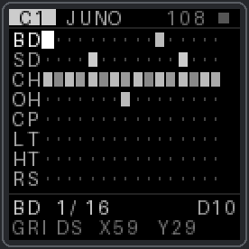

### Sampler
- **Einen Break neu zusammensetzen:**
  1. Loop mit genau 1 Takt laden.
  2. SLICES 8 und TAKT-SYNC 1 TAKT einstellen.
  3. **AUF DRUMS VERTEILEN** drücken.
  - Die Drum-Spur spielt jetzt den Loop wie das Original. Du stellst die Steps um, und das Tempo bleibt frei wählbar.
- **Resampling:** AUFNAHME mit QUELLE MIX, EINHEIT TAKTE und START TAKT 1. Damit nimmst du einen Durchlauf des Sequencers taktgenau auf, und der neue Slot ist sofort im Tempo.
- **KeyStep Pro als Pad-Controller:** Eine Drum-Spur des KeyStep auf den PAD-KANAL stellen.
  - Die Noten 36–43 spielen die Slots.
  - Ab Note 44 spielen sie die Slices des SLICE-SLOT.
  - Kommt nichts an, zeigt SETUP › MIDI › MONITOR den Grund.

### Effekte und Rechenlast
- **Busse planen:** 0 = Synths, 1 = Drums und Pads, 2 = AUDIO IN, 3 = frei, z. B. für den VCO (VCO › BUS 3). So hat jede Gruppe ihren eigenen Hall, ihr eigenes Echo und ihre eigene Verzerrung.
- **Drums dichter:** Auf Bus 1 DISTORTION CLIP mit BUS DRIVE 2–4 einstellen.
- **Juno-Patches klingen dünn?** Lass PATCH-FX auf dem Bus AN, denn Chorus und EQ gehören zum Juno-Klang.
- **Rechenlast:**
  - Eine Juno-Stimme kostet etwa 12 %, eine DX7-Stimme etwa 8 %, ein Drum-Schlag etwa 2 %.
  - Slots mit TAKT-SYNC kosten das 2,5-Fache.
  - Oben rechts im MIXER steht der Stimmenverbrauch. Lieber Stimmen pro Kanal begrenzen als FAILSAFE auslösen lassen.

### Modular
- **Erst kalibrieren** (MODULAR › KALIBRIERUNG): zuerst die Ausgänge mit dem Multimeter, dann die Eingänge per ABGLEICH. VCO, QUANTIZE, MIDI>CV und GATE+PITCH bauen alle darauf auf.
- **Spannungsbereiche:**
  - Die Eingänge messen etwa −10 bis +6,3 V, das sind rund 6 Oktaven über C1.
  - Die Ausgänge geben −10 bis +10 V aus.
- **Wer belegt welchen Ausgang?**

  | Modus | Belegt |
  |---|---|
  | QUANTIZE und CV1>OUT1 | nur OUT1 |
  | CV2>OUT2 | nur OUT2 |
  | MIDI>CV und 303>CV | beide Ausgänge |

  Ein freier Ausgang kann CV MOD (LFO/ENV) oder einen Drum-Trigger ausgeben.
- **Der CV-Monitor** oben auf MODULAR verrät Kabelfehler. Bleibt ein Wert beim Umstecken stehen, kommt kein Signal an.
- **VCO für Drones:** GLAETTUNG STARK, dazu VCO OSZ 2 mit INTERVALL +7 und etwas DETUNE.
- **Keine Rückkopplung:** Den Audio-Ausgang des AMYboards nicht auf den eigenen Eingang patchen, solange AUDIO IN läuft.

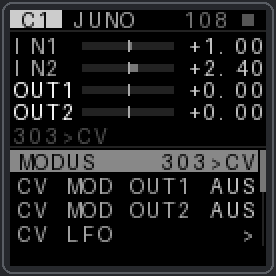 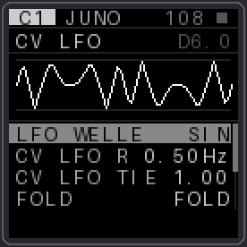

### Fehlersuche in einer Minute
| Problem | Erst hier nachsehen |
|---|---|
| Noten oder Pads reagieren nicht | SETUP › MIDI › MONITOR |
| Encoder fehlt | SETUP › ENCODER › I2C-SCAN |
| CV kommt nicht an | CV-Monitor oben auf MODULAR |
| Aufnahme bleibt stumm | SAMPLER › AUFNAHME › EINGANG TESTEN |
| Takt holpert | SETUP › INFO › Messwerte (BEDIENUNG MAX unter 250 ms?) |
| Einstellungen weg | Vor dem Ausschalten STOP drücken oder ein paar Sekunden warten |

---

## 7. Patch-Vorschläge für MODULAR

Die Beispiele nutzen Module aus einem Doepfer-Rack mit KeyStep Pro und Mischpult. Jedes vergleichbare Modul geht genauso: ein VCO mit 1 V/Okt, ein Filter mit CV-Eingang, ein VCA, eine ADSR-Hüllkurve, ein LFO. In den Bildern steht jeweils, was am AMYboard einzustellen ist.

**Kabelfarben:** blau = Tonhöhe (1 V/Okt), grün = Gate/Trigger, orange = Audio, lila = Modulation, grau gestrichelt = MIDI.

### 1 · AMYboard als VCO, gespielt vom KeyStep Pro
Das AMYboard wird zum zweiten Oszillator im Rack. Hüllkurve und VCA kommen aus dem Rack, der Klang bekommt die Effekte des AMYboard-Busses.

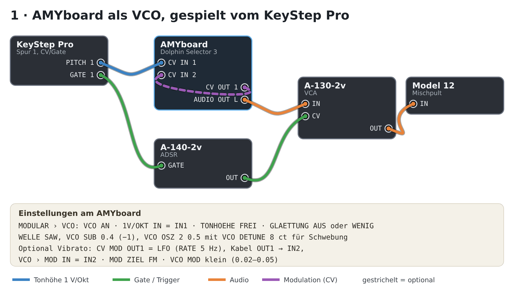

- **Kabel:** KeyStep PITCH 1 → CV IN 1 · KeyStep GATE 1 → A-140-2v GATE · A-140 OUT → A-130 CV · AMYboard AUDIO OUT L → A-130 IN · A-130 OUT → Mischpult.
- **Tipp:** Erst Patch 7 machen (Stimmen), dann sitzen die Oktaven.
- **Variante:** Ein Kabel OUT1 → IN2 mit CV MOD OUT1 = LFO ergibt Vibrato, ganz ohne weiteres Modul.

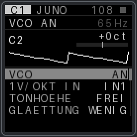

### 2 · Die 303-Spur spielt den Doepfer-VCO
Die interne 303-Spur mit ACID-GENERATOR, Slide und Accent steuert einen analogen Oszillator und ein analoges Filter.

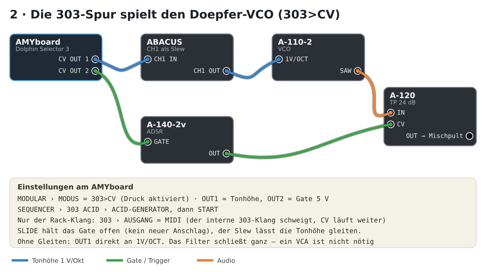

- **Kabel:** OUT1 → ABACUS CH1 IN → CH1 OUT → A-110-2 1V/OCT · OUT2 → A-140-2v GATE · A-110 SAW → A-120 IN · A-140 OUT → A-120 CV · A-120 OUT → Mischpult.
- **Slide:** SLIDE hält das Gate offen, die Hüllkurve startet also nicht neu. Das Gleiten der Tonhöhe macht der Slew (ABACUS CH1, Rise/Fall kurz). Ohne Slew springt die Tonhöhe.
- **Nur der Rack-Klang:** 303 › AUSGANG = MIDI. Dann schweigt die interne 303, die CV-Ausgabe läuft weiter. Mit BEIDE spielen beide zusammen.
- **Rack-Filter dazu:** Lass die Hüllkurve kurz und die Resonanz hoch, dann klingt es typisch nach Acid.

### 3 · Die Drum-Spur triggert das Rack
Bis zu zwei Drum-Instrumente geben Trigger aus, tick-genau mit dem internen Klang.

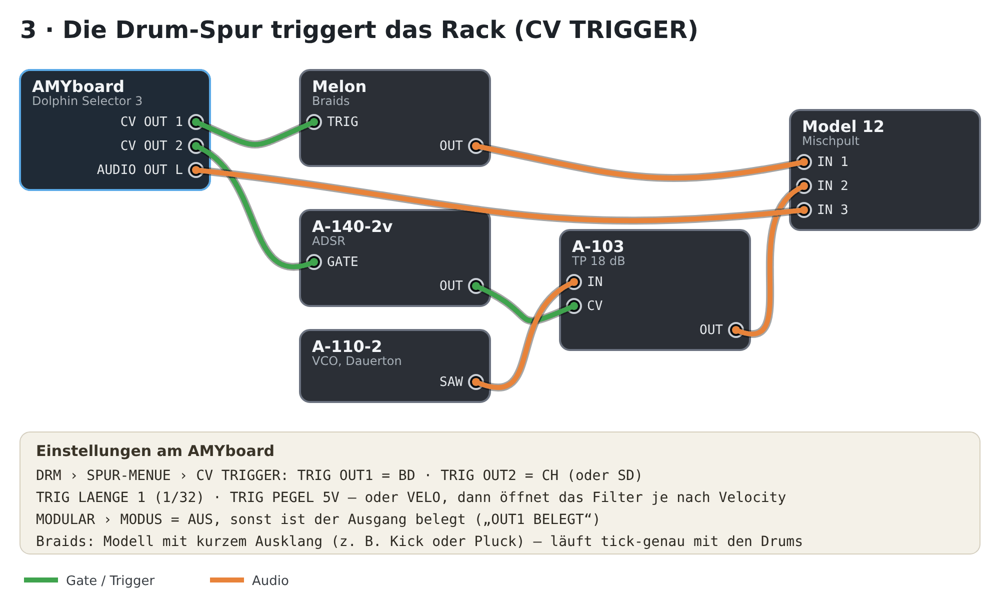

- **Kabel:** OUT1 → Melon TRIG · OUT2 → A-140-2v GATE · A-140 OUT → A-103 CV · A-110-2 SAW → A-103 IN · Ausgänge → Mischpult.
- **Ergebnis:** Die Braids-Stimme spielt mit der Bassdrum. Das Filter auf dem Dauerton des A-110 öffnet sich im HiHat-Rhythmus.
- **TRIG PEGEL VELO:** Die Velocity der Steps wird zur Spannung. Leise Steps öffnen das Filter weniger.
- **Sidechain-Pumpen:** Bassdrum-Trigger → Hüllkurve, deren invertiertes Signal einen VCA zuzieht. Dafür brauchst du ein Modul mit invertiertem Ausgang oder einen Attenuverter mit Offset.

### 4 · AMYboard als Effektgerät
Jeder Klang aus dem Rack geht durch Verzerrung, Filter, Echo und Hall des AMYboards.

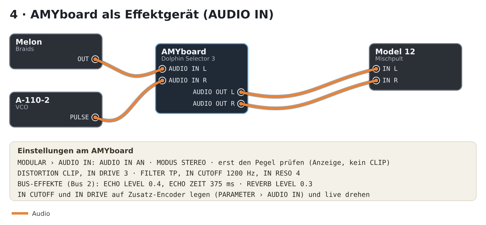

- **Kabel:** Melon OUT → AUDIO IN L · A-110-2 PULSE → AUDIO IN R · AUDIO OUT L/R → Mischpult.
- **Pegel zuerst:** Die Anzeige auf der AUDIO-IN-Seite läuft schon bei AUS. Pegel so einstellen, dass kein CLIP erscheint, und erst dann einschalten.
- **Live spielen:**
  - IN CUTOFF und IN DRIVE auf zwei Zusatz-Encoder legen.
  - Ein Taster mit der Funktion AUDIO IN schaltet den Eingang von jeder Seite aus an und aus.
- **Typen wechseln:** FILTER- oder DISTORTION-Typ wechseln klickt nicht mehr (v13.27). Das geht also auch mitten im Stück.

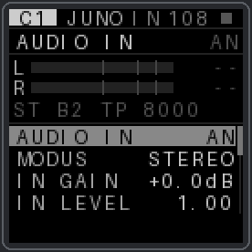

### 5 · Generative Melodie mit dem Quantizer
Ein langsamer LFO wird zur Melodie in einer Tonleiter. Ein zweiter LFO gibt den Rhythmus.

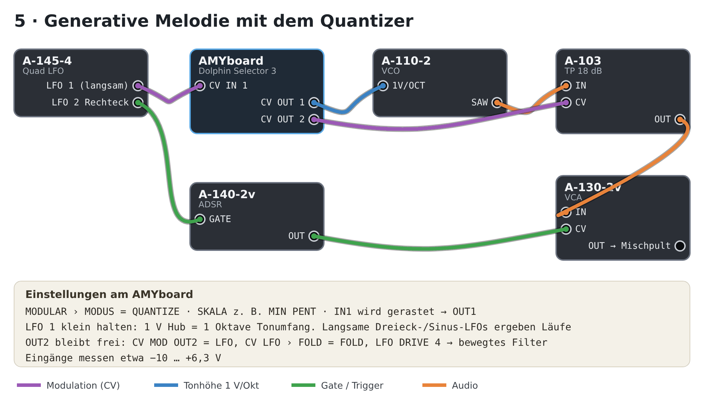

- **Kabel:** A-145-4 LFO 1 → CV IN 1 · OUT1 → A-110-2 1V/OCT · LFO 2 (Rechteck) → A-140-2v GATE · A-110 SAW → A-103 IN → A-130 IN · A-140 OUT → A-130 CV · OUT2 → A-103 CV.
- **Tonumfang:** 1 V Hub sind 1 Oktave. Mit einem kleinen LFO-Pegel bleibt die Melodie singbar.
- **Ausprobieren:**
  - Dreieck-LFOs ergeben Läufe auf und ab.
  - Sinus wird an den Wendepunkten langsamer.
  - Ein zufälliges Signal (z. B. vom ABACUS) springt.
- **OUT2 bleibt frei:** CV MOD OUT2 = LFO mit FOLD bewegt das Filter.

### 6 · Drums, die sich bewegen
Zwei langsame Spannungen schieben GRIDS über die Karte, und das Drum-Muster verändert sich von selbst.

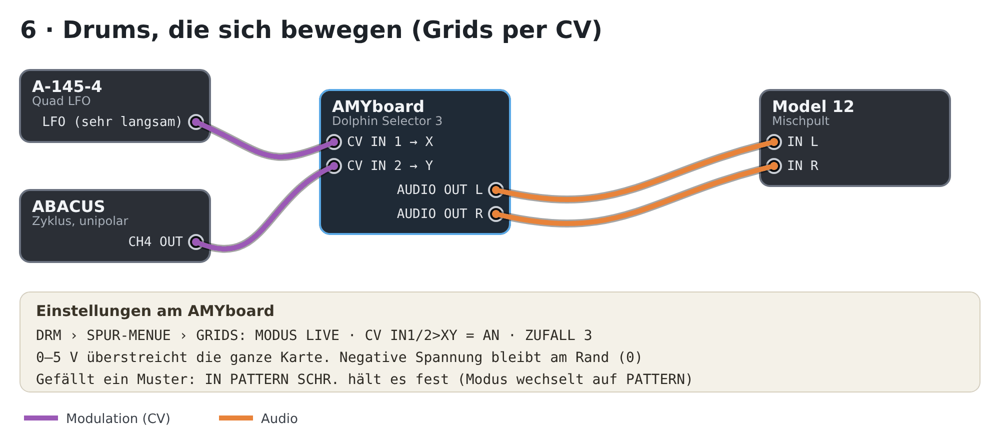

- **Kabel:** A-145-4 LFO (sehr langsam) → CV IN 1 (X) · ABACUS CH4 (zyklisch, unipolar) → CV IN 2 (Y).
- **Spannung:** 0–5 V überstreichen die ganze Karte. Negative Spannung hält am Rand, also besser unipolare Quellen nehmen.
- **Festhalten:** Kommt ein gutes Muster vorbei, hält es IN PATTERN SCHR. fest.

### 7 · Ein Kabel zum Stimmen
Das AMYboard stimmt seinen eigenen VCO mit genauen Spannungen.

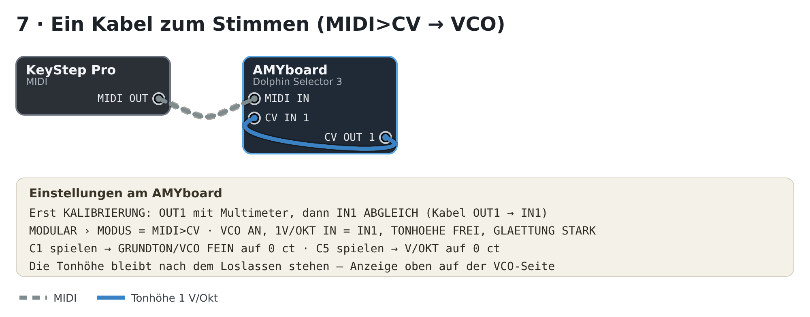

- **Kabel:** KeyStep MIDI OUT → AMYboard MIDI IN · CV OUT 1 → CV IN 1.
- **Ablauf:**
  1. MODULAR › MODUS auf MIDI>CV stellen.
  2. C1 spielen und GRUNDTON und VCO FEIN auf 0 ct stellen.
  3. C5 spielen und V/OKT auf 0 ct stellen.
  - Die Tonhöhe bleibt nach dem Loslassen stehen. Mit GLAETTUNG STARK steht die Anzeige ruhig.

---

## 8. Hinweise zur Sketch-Datei

- `sketch.py` fürs Board wird **ohne Kommentare** ausgeliefert (~300 KB) und lädt etwas schneller. Die kommentierte Fassung `claude/sketch_src.py` (~390 KB) läuft auf dem Board ebenfalls (getestet). Bei v13.11 reichte dafür der Speicher noch nicht.
